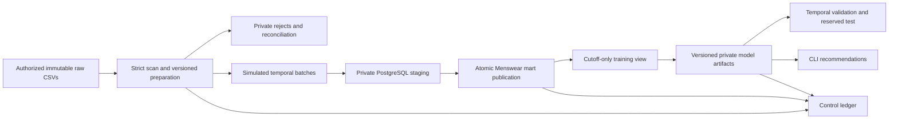
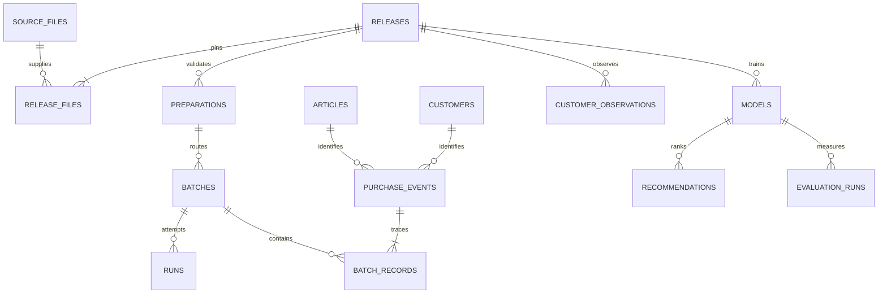

# Stage 1 architecture and data contract

Status: proposal, not implemented. This document specifies the later implementation and its acceptance obligations.

## Requirements and boundaries

Read the three authorized historical CSVs, retain exactly `index_group_name == "Menswear"`, validate with Python, and automatically load PostgreSQL. Preserve identifiers, legitimate identical purchase occurrences, missing optional values, and canonical provenance. Generate up to 12 unique Menswear article IDs for the next seven days. All primary workflows must run from a CLI, without notebooks. No frontend, images, deep learning, deployment, or distributed infrastructure.

Menswear is a product taxonomy; it says nothing about customer gender. Sport and Divided are excluded. A source row is a recorded purchase occurrence, never a verified order or basket. No real-currency revenue, profitability, causal uplift, or live stock availability is inferred.

## Components and reproducibility

Proposed runtime: Python 3.12, PostgreSQL 18, pandas for bounded CSV chunks, Psycopg 3 for parameterized SQL and `COPY FROM STDIN`, NumPy/SciPy for sparse arithmetic, pytest for unit and real-PostgreSQL integration tests, and Git/GitHub for version history. Standard-library `csv`, `decimal`, `datetime`, `hashlib`, and `argparse` provide strict structural validation, exact decimals, dates, checksums, and commands. An ORM, deep-learning framework, and external model service are unnecessary.

Stage 2 will resolve compatible stable releases, pin the exact Python patch, database patch/image digest, direct/transitive dependencies and hashes in a lock, and verify a clean installation. These are proposed version families, not a claimed reproducible installed project yet. The local bundled inspection environment is not the project's dependency contract.

Separate modules: `extraction`, `transformation`, `validation`, `loading`, `recommendation`, `evaluation`, and `cli`; numbered SQL migrations with checksum ledger; synthetic tests independent of restricted records. No notebooks on the critical path.

Official API references: [pandas CSV](https://pandas.pydata.org/docs/reference/api/pandas.read_csv.html), [Psycopg COPY](https://www.psycopg.org/psycopg3/docs/basic/copy.html), [PostgreSQL locks](https://www.postgresql.org/docs/18/explicit-locking.html), [SciPy sparse arrays](https://docs.scipy.org/doc/scipy/reference/sparse.html). References justify interfaces, not performance or model quality.

## Layers and flow

Raw originals remain untouched outside the repository. Preparation is private, streamed and immutable once complete. PostgreSQL staging is private and cannot qualify as a completed mart. Publication is atomic per dated batch. A model's training input is an immutable cutoff snapshot of committed data; later batches cannot change a fitted artifact.

The full source is scanned to select Menswear and check references. Retain only a minimal cross-segment observation registry (`customer_id`, earliest valid identity/date/reference observation date) to define customers known at prediction time; no non-Menswear purchase payloads enter the mart or ranking model. This narrowly scoped registry supports known customers with no Menswear history. It is not a demographic feature or a customer-registration date.

The Menswear catalog is a static taxonomy snapshot without effective dates. Use it only to define this retrospective case-study scope. Candidate availability requires past purchase evidence; no names, descriptions, price, or uncertain product/customer attributes enter ranking initially. Historical accuracy of the taxonomy itself cannot be established from these files.

## Identity and immutable source policy

| Entity | Technical identity and contract |
| --- | --- |
| File | Namespace, role, SHA-256 of uncompressed CSV bytes, byte size; filename is metadata |
| Release | Immutable manifest of the three role/hash pairs plus parser, validation, scope and contract versions |
| Source purchase | `(transaction_file_id, source_record_number)`, one-based logical CSV data-record ordinal before scope/date filtering; header excluded |
| Preparation | Release and contract plus verified output hashes, row counts, completed flag |
| Batch | Unique release/contract and half-open date window `[start, end)` |
| Attempt | New UUID on every invocation, including retries and completed-batch no-ops |
| Model | Content-addressed manifest: release, committed input batch set/snapshot hash, cutoff, training configuration, code commit, lock hash, candidate/ID mapping hashes, seed and artifact hashes |

Identical rows at two positions remain two facts. Field hashes may check payload consistency but cannot identify real-world transactions. Logical ordinals must remain stable across chunk sizes, including quoted multiline records.

Same bytes renamed reuse identity. Rerunning a completed matching batch logs a no-op. Overlapping windows from the same release insert only unseen source identities, retain separate batch membership, and reconcile inserted versus reused counts. Facts are counted once; never sum overlapping batch totals to count purchases. Existing identity with a different validated payload is an error.

Changed bytes, reordering, formatting changes, new dimension snapshots, or changed contracts are blocked from additive promotion after a lineage is active. Register them as replacement candidates, never infer overlap from equal purchase fields. Initial scope supports exactly one active release/contract lineage, enforced under a singleton lineage lock; a new label cannot bypass it. Future snapshots require an explicitly reviewed full rebuild into an isolated generation and an atomic generation switch, retaining old provenance. That replacement feature is deferred, with a clear error instead of an unsafe append. Independent exports lacking canonical row provenance are unsupported.

Incremental arrival is explicitly simulated by dated windows from this one immutable source; it is not an internal H&M API. Preparation scans full data for validation but must not expose post-cutoff observations or labels to model fitting.

## Proposed table dictionary

All identifiers and codes are text, dates are `date`, timestamps are UTC `timestamptz`, source ordinals/counts are `bigint`, operational identities are UUIDs, SHA-256 values have a validated 64-hex format. No personal local paths in committed configuration; private file locations are local control metadata only.

| Table | Grain / fields | Key constraints and visibility |
| --- | --- | --- |
| `control.source_files` | File role, namespace, digest, bytes, private location | Unique role/namespace/digest; immutable |
| `control.releases`, `control.release_files` | Manifest and three role assignments | One per role, pinned contract; singleton active lineage |
| `control.preparations` | Release, contract, checksums, dispositions, completion | Only verified complete artifacts loadable |
| `control.batches` | Release/window, preparation, status, committed counts | Unique definition; start < end |
| `control.runs` | Attempt, batch, lifecycle, timestamps, safe error code | Durable attempt audit; no raw exception/payload |
| `control.batch_records` | Batch membership of accepted source purchase identity | Unique batch/file/ordinal; FK to fact identity |
| `quality.rejections` | Preparation, role, ordinal, primary and additional reason codes | One primary rejected disposition; private, no payload in logs |
| `staging.articles`, `staging.customers`, `staging.purchase_records` | Preparation-specific parsed data and outcomes | Private indexed lookup; incomplete preparation unpublishable |
| `mart.articles` | All 12,553 scoped catalog IDs; original taxonomy/descriptors | PK `article_id`; exact Menswear constraint; catalog presence alone never makes a candidate |
| `mart.customers` | Customers with a committed Menswear occurrence; ID and nullable source metadata | PK `customer_id`; optional FN/Active remain nullable source codes; no postal code required |
| `mart.customer_observations` | Customer first observed under the minimal identity/date/reference contract | PK release/customer; earliest date with canonical source-record provenance; rows gated to committed date windows |
| `mart.purchase_events` | Source file/ordinal, article/customer, date, exact price, channel, first batch | Unique file/ordinal; article/customer FKs; numeric finite >= 0 price; channel codes `1`/`2` |
| `control.models` | Model manifest, cutoff, input snapshot, status, safe local artifact reference | Complete/verified artifacts only; immutable lineage |
| `serving.recommendations` | Model/customer/rank/article, score, fallback reason | Private; rank 1..12, unique model/customer/article and model/customer/rank |
| `evaluation.runs` | Protocol/config hashes, split, model, aggregate metrics/cohort counts | No customer-level metrics in Git; final test consumption recorded |

Customer fields (when retained): `FN`, `Active` as nullable original code text; `club_member_status`, `fashion_news_frequency` as nullable text; `age` as nullable validated source integer. They are auditable snapshot metadata, never temporal model inputs. `postal_code` remains in private raw only. Product metadata retains original code/text types; missing descriptions are null. `price_source_units` uses unconstrained PostgreSQL `numeric` and exact Decimal parsing; no invented fixed scale or currency. No transaction/order surrogate is presented as an actual source order ID.

Observation validity is a separate minimal contract: a structurally parsed record with nonempty format-valid customer/article IDs resolving to pinned dimension keys, plus a canonical calendar-valid date. Non-Menswear price/channel tokens and optional customer metadata are not inputs to this registry. A financial-field rejection does not erase otherwise valid identity/date/reference evidence, and a registry row never certifies an accepted purchase fact. Unknown references and invalid dates cannot establish an observation. Malformed file structure still fails the whole preparation.

The observation registry's earliest record comes from the complete scan, but publication includes a customer only when that first observation falls within committed temporal windows. A training snapshot also filters `first_observed_date <= cutoff`. Model creation requires complete committed coverage from source start through cutoff, with no missing intervals. Later incremental batches cannot introduce early missing history into an already frozen training snapshot.

## Validation, rejection, and reconciliation

IDs preserve original text including leading zeros; no integer conversion, padding, or global whitespace repair. Actual ID format checks are explicit contracts based on inspection (article: ten digits; customer: 64 lowercase hexadecimal characters). All code-like catalog fields remain text even when numeric-looking. Empty optional fields become null; literal tokens such as `NA` are not globally treated as null. No fabricated values, no absent FN/Active -> false.

Malformed CSV structure, invalid encoding, missing/duplicate/unexpected headers, duplicate dimension keys or damaged file integrity fail the whole preparation; never silently skip parser errors. Pandas can pad short records, so structural column-count validation is an explicit independent gate. Assign ordinals before filtering.

Missing/invalid required transaction ID/date/price/channel, unknown references, and unusable mandatory catalog scope produce stable row rejection codes. Dates must be canonical `YYYY-MM-DD` and calendar-valid. Heterogeneous/ambiguous dates in synthetic tests are rejected under this initial contract. Finite Decimal >= 0 required; zero accepted and counted. Channel text `1`/`2` accepted as observed source domain, with no semantic labels. Missing description/name is accepted as null. Present malformed optional metadata rejects the dimension record and affected references; no silent imputation. Duplicate dimension IDs fail preparation even when identical.

Determine one primary disposition in order: required-field/format/reference validation; valid product scope; date routing. An invalid date cannot be assigned to a dated batch. Count all such rejections once at preparation level. Additional reasons never inflate rejected-row totals. Out-of-scope valid rows are not defects.

Preparation: `source_rows = rejected_rows + valid_out_of_scope_rows + valid_menswear_rows`.
Batch: `valid_menswear_rows = outside_window_rows + accepted_in_window_rows`.
Publication: `accepted_in_window_rows = newly_inserted_rows + already_present_rows = batch_memberships`.
Under the publication lock: `fact_count_after - fact_count_before = newly_inserted_rows`.
Dimension/observation counts and rejects have separate denominators. Never count preparation rejects repeatedly as newly rejected data in each temporal batch. A zero-row valid window may complete; changed manifests cannot masquerade as no-ops.

## Atomicity, concurrency, and recovery

Use a dedicated unpooled connection. Before durably registering an attempt, acquire its UUID-derived session advisory ownership lock. Hold it through preparation/waiting/publication and terminal outcome; loss of connection ends ownership and prohibits reconnect-and-resume for the old attempt. Hash collisions can delay ownership, never grant concurrent ownership.

After preparation completes, start a transaction and lock the singleton lineage row with `SELECT ... FOR UPDATE`; this serializes all publication, including overlap. Revalidate release, contract, complete preparation and live owned attempt. Find/create unique batch; completed matching definition returns no-op. Publish dimensions, dated observation registry, facts and batch membership; verify equal payloads for reused identities. Reconcile counts and mark batch plus run successful in the same transaction. Constraint violation or count mismatch rolls everything in that publication back. Previous completed batches stay visible.

Record sanitized failure on a separate connection if possible, never overwrite committed success. For uncertain commit, query the batch ledger before deciding whether to retry. For abandoned attempts, recovery must first obtain the attempt ownership lock, then lineage lock in that order; a live preparing/queued worker cannot be declared dead based on age. Check committed outcome and conditionally mark only nonterminal abandoned attempts interrupted. A retry receives a new UUID. Partial staging and partial artifact files never become completed inputs. Model directories use temporary write, checksum verification and atomic rename plus registry completion; incomplete artifacts cannot serve.

## Security and operations

Owner/migrator, loader, model operator and read-only consumer roles have separate privileges; runtime roles cannot create roles, databases or schemas. Revoke unnecessary PUBLIC privileges; test actual effective access. Consumer cannot see raw/staging/customer metadata. Parameterize values and use fixed or safely composed SQL identifiers. Local environment variables with a secret-free `.env.example`; no URLs, SQL parameters, customer IDs or connection strings in logs. CLI recommendation output is intentionally private and may contain only the requested customer's ranked products; documentation examples use synthetic IDs.

Logs contain run/batch/model IDs, stage, elapsed duration, counts and safe reason codes. Git excludes originals, derived data, dumps, row-level rejects, logs, models, predictions, credentials and personal paths, even in a private repo. Model mappings/similarities can expose restricted data and remain local. A code license never licenses H&M data.
